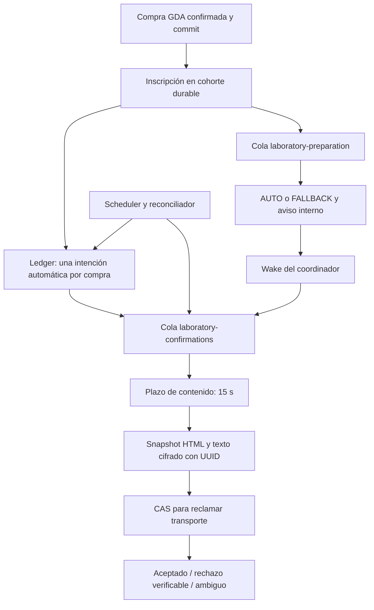

# Indicaciones IA v3 — Bloque B: correo único

Fecha local: 2026-10-16. Proyecto `/home/usuario/projects/famedic`, rama `feature/indicaciones-ia-v3-mejoras`, HEAD conservado `67dbf35d1c63d187e355c5334c8b91c5565b478a`.
Referencia selectiva: `10e439d84cd4e691d24073b1df0490cd8d572aa7`. No se hizo merge ni cherry-pick.

## Resultado

Integrado el coordinador durable de confirmación de compra, manteniendo rollout OFF y fecha vacía por defecto. No se activó ningún flag de la aplicación habitual. El resultado para una nueva cohorte habilitada, dentro de las pruebas aisladas, es una confirmación automática con AUTO vigente generado dentro del plazo o indicaciones originales completas. El resumen posterior mantiene el aviso interno y suprime el segundo correo automático.

**454 casos PHP distintos correctos y 6,299 aserciones**, incluidos los **403 casos anteriores, sin nombres ausentes ni regresiones**. JavaScript: 109 PASS, 0 FAIL y 1 SKIP preexistente de Chromium por `libnss3.so`. Build cliente/SSR correcto.

**GO para pruebas locales aisladas con proveedores y transporte simulados.** El uso del checkout/correo contra la base habitual sigue pendiente de autorización y aplicación de las migraciones; no se autoriza activación ni correo real mediante este informe.

## Dependencias reconciliadas y preservación

- El coordinador usa `GdaOrderStatus::Confirmed` y la validación estructural GDA/P0 existente. Compras `pending`, `uncertain`, `failed`, sin estado explícito o eliminadas no generan una nueva entrega coordinada. Se vuelve a verificar confirmación antes de transportar un snapshot preparado.
- La inscripción ocurre después del commit de compra confirmada. Incluso un fallo del contenedor al resolver el coordinador queda aislado del resultado financiero: no falla la compra ni dispara reembolso. La recuperación de comunicaciones usa el reconciliador, nunca fulfillment.
- Las acciones de cobro, PayPal, Odessa, `OrderAction`, guardas P0, enum, modelo de compra, webhook financiero y sus pruebas quedaron byte por byte iguales al inicio de B. En fulfillment solo se modificó la selección de comunicaciones posteriores al commit, enrutamiento de generación y diagnóstico seguro de esa cola.
- El monitor, sus rutas/componentes/servicio y pruebas no cambiaron. Las clases clínicas, R01–R18, prompts, Presenter, reglas, validadores y elegibilidad permanecen intactos.
- Se conservan `action_url`, `resultReports()`, centro de resultados, TestCase, runners y servicios/drivers de ActiveCampaign. El servicio de notificación recibió solo wake/supresión; el job de preparación conserva tries/backoff y P2, añadiendo wake al fallo.
- `LaboratoryPurchaseConfirmationViewData` conserva hidratación de paquetes, importes, descuentos y contactos originales; solo recibe un override opcional de presentación. No se reemplazó el archivo con el de referencia.
- La plantilla con cita conserva su rama legacy. Su rama unificada ahora incluye identificadores/paciente, cita/sucursal y preparación, sin prometer otro correo con esos datos. La notificación por cambios reales de cita no tiene un guard global de supresión.

## Arquitectura



La tabla `laboratory_purchase_confirmations` funciona como ledger/outbox. La clave automática `laboratory_purchase:{id}:confirmation` es UNIQUE. Los reenvíos administrativos son eventos separados con UUID y `requested_by`, conservando la autorización de la ruta original.

La tabla `laboratory_confirmation_rollouts` fija una sola frontera de cohorte. Desactivar el flag después de crearla pausa entregas; no devuelve esas compras al envío legacy. El reconciliador recupera omisiones de inscripción de compras confirmadas dentro de esa frontera y despachos pendientes, sin repetir cobro/GDA/fulfillment.

| Estado de intención | Comportamiento |
| --- | --- |
| `waiting` | Espera AUTO hasta el deadline o selecciona originales ante una resolución conocida. |
| `preparing` | Preparación reclamada con token y lease; una interrupción es recuperable. |
| `ready` | HTML/texto/destinatario/asunto congelados y cifrados; `snapshot_version` identifica esa versión. |
| `sending` | Transporte reclamado por CAS; un segundo worker no puede enviar el mismo snapshot. |
| `retry_wait` | Solo rechazo verificable: vuelve a intentar exactamente el payload fijado. |
| `accepted` | Acuse de aceptación del transporte; no prueba lectura ni llegada al inbox. |
| `ambiguous` | Timeout, desconexión, muerte del worker o pérdida del acuse: sin reintento automático. |
| `failed` / `cancelled` | No entrega automática adicional. Requiere revisión según código seguro. |

La preparación tiene un UUID de snapshot distinto del identificador de intento. Invalidar/reclamar contenido usa CAS por UUID, estado e intento; un lector viejo no borra ni envía una versión nueva. Después de iniciar transporte, los reintentos no reconstruyen el contenido aunque cambien indicaciones, flags o AUTO.

## Contenido y supresión

- **AUTO:** se usa el Presenter existente, decisión `AUTO_CONSOLIDATED`, fuente vigente y `generated_at <= deadline`. No se espera OpenAI dentro del checkout. El límite de selección inicial es 15 segundos, no una garantía de llegada del correo en 15 segundos.
- **FALLBACK / IA OFF / fallo / vencimiento / resultado tardío:** originales completos de los items de compra. Se preservan paquetes y múltiples estudios; no se truncan indicaciones para el nuevo correo.
- **Con y sin cita:** se conservan compra, importes, paciente, identificadores, estudios y los datos de cita que correspondan. Se probaron HTML y texto con originales extensos y paquetes.
- **Texto limpio:** la implementación de referencia usaba `renderText` sobre plantillas con HTML explícito y podía conservar etiquetas. Se deriva la alternativa de texto desde el mismo HTML escapado mediante DOM, conservando enlaces, saltos y literales como `<5mL>` y `&`, sin tags ni CSS. No se cambia el contenido clínico ni el Presenter.
- **Segundo correo IA:** se suprime después de crear el aviso interno, sin perder `action_url`. Un resultado tardío no modifica el snapshot aceptado ni genera otro correo automático.
- **Legacy ya encolado:** `shouldSend` se comprueba en ejecución tanto en la confirmación legacy como en el resumen IA. Se probó una notificación serializada con `SendQueuedNotifications` y el dispatcher real de Laravel: se suprime para la cohorte y se conserva para una compra histórica.
- **Cambios de cita:** solo se suprime el eco de cita provocado por el fulfillment coordinado; una notificación posterior por cambio de cita sigue funcionando.
- **Reenvío administrativo:** intención auditada independiente, sin envío inline. Una compra sin confirmación GDA verificable recibe error de validación en el flujo durable. El flag de entrega OFF pausa también las intenciones de reenvío de una cohorte existente.

## UTC y MAIL_URL

La aplicación local tiene `APP_TIMEZONE=America/Mexico_City`; no se modificó. La frontera ISO con offset se normaliza a UTC antes de persistirla. Al reconciliar, se convierte al horario de las fechas de compra que usa Laravel en la consulta existente. Se probaron `-06:00`, `+05:30`, UTC, compras inmediatamente anteriores y posteriores, y reconciliación con reloj/fechas de México. Las fechas relativas, sin offset y futuras no habilitan entregas. Operativamente se deben elegir fronteras explícitas a segundo completo y no mover una frontera ya persistida.

`Mail::build()` no realiza por sí mismo la resolución de `MAIL_URL` que sí hace `MailManager::getConfig()`. El adaptador resuelve la URL con el parser de Laravel antes de construir el mailer: host, puerto y credenciales percent-encoded se conservan. El timeout se aplica **después** de resolver la URL; una opción `timeout=999` no elude el límite de 20 segundos. Todo se probó con datos sintéticos y transporte array, sin SMTP real ni impresión de credenciales.

Se rechazan transportes compuestos `failover/roundrobin` y transportes no admitidos; `array` solo se permite en testing. Se mantienen direcciones globales de Laravel y la política de seguridad de correo del proyecto. El mailer no se cambia globalmente. El timeout se limita a 1–30 segundos, valor inicial 20; se inhibe el reinicio SMTP tras aceptación y los retries SDK de SES. Un rechazo SMTP verificable puede reintentarse; desconexiones/timeouts no se convierten en rechazo seguro.

## Configuración y operación pendiente

Valores seguros del código, sin cambios en `.env`:

```ini
LAB_CONFIRMATION_COORDINATOR_RELEASE_READY=false
LAB_CONFIRMATION_COORDINATOR_ENABLED=false
LAB_CONFIRMATION_COORDINATOR_ACTIVATED_AT=
LAB_CONFIRMATION_CONTENT_WAIT_SECONDS=15
LAB_CONFIRMATION_QUEUE_CONNECTION=database
LAB_CONFIRMATION_QUEUE=laboratory-confirmations
LAB_CONFIRMATION_GENERATION_QUEUE=laboratory-preparation
```

La inspección final encontró valores **preexistentes** en `.env`: flag operativo true y fecha no vacía. No se cambiaron ni se reutilizaron para activar. Se añadió `LAB_CONFIRMATION_COORDINATOR_RELEASE_READY`, false por defecto, como habilitación explícita de esta integración. `laboratory-confirmation.enabled` requiere ambas condiciones. Por eso el coordinador queda efectivamente desactivado aunque existan valores experimentales anteriores. La prueba configura esos valores solo en su proceso y confirma OFF sin release-ready y ON únicamente con ambos gates. Antes de una futura activación se deben revisar/normalizar los valores anteriores y elegir una frontera nueva; no basta habilitar release-ready conservando una fecha antigua.

El AUTO continúa usando el flag existente `LAB_PREPARATION_DETERMINISTIC_V3_ENABLED`; B no lo activa. `max_attempts=3`, delays `[30,120]`, lease mínimo 120 segundos y job de confirmación con timeout 60 y un solo intento de cola. El ledger gobierna los reintentos.

Para una futura prueba autorizada fuera de las bases descartables:

1. Revisar y aplicar las tres migraciones pendientes — GDA/P0 y las dos de confirmación — con rollout OFF. No se ejecutaron sobre la base habitual. No hay backfill de compras ni ajuste de datos históricos.
2. Verificar configuración efectiva/cache y reiniciar workers existentes para cargar código nuevo antes de crear una cohorte. No mezclar workers antiguos con la activación.
3. Mantener workers independientes para `laboratory-confirmations` y `laboratory-preparation`; la validación de código rechaza sync y nombres de cola iguales para la cohorte. No basta configurar nombres si un solo proceso atiende ambas colas.
4. Configurar timeouts y `retry_after` compatibles antes de habilitar: confirmación 60 s y transporte 20 s; preparación debe superar el timeout OpenAI existente (60 s por defecto). Una combinación futura posible es preparación 120 s y `DB_QUEUE_RETRY_AFTER=180`, siempre revisando los demás consumidores de esa conexión antes de alterar valores compartidos. Estos son requisitos operativos, no cambios aplicados.
5. Verificar scheduler cada minuto y `laboratory-confirmations:reconcile`. El comando `laboratory-confirmations:reconcile --review` lista solo IDs, estado, intentos, actor y códigos seguros; no muestra snapshots.
6. Verificar mailer efectivo, `MAIL_URL` y allowlist del modo seguro con un destinatario QA autorizado. La prueba actual no certifica credenciales/proveedor real ni autoriza enviar.
7. Revisar trabajos legacy pendientes y su cohorte; los guards de ejecución ayudan con jobs serializados, pero no pueden deshacer un correo ya enviado por un worker antiguo. No drenar ni reintentar masivamente.
8. Solo con autorización separada, definir una frontera futura con offset explícito, preparar una única compra QA nueva y observar su intención. La frontera debe separar las compras que aún podían haber recibido legacy. No se hizo ninguna compra real en esta implementación.

**Pausa:** poner el flag de entregas OFF mediante una operación futura autorizada; conservar la frontera persistida y el ledger. No borrar intenciones ni cambiar la fecha para volver a legacy. Las compras de esa cohorte siguen suprimidas y pueden acumular intenciones pendientes.

**Reanudación:** restaurar el flag con la misma frontera y workers/configuración verificados, ejecutar/verificar el reconciliador y revisar pendientes. El plazo original no se renueva; AUTO tardío conduce a originales. `ambiguous` no vuelve a enviar automáticamente. Conciliar primero con el proveedor; un reenvío administrativo explícito puede duplicar un correo que sí hubiera sido aceptado y requiere juicio del operador.

Un fallo al determinar propiedad de cohorte se trata de forma conservadora: no se envía legacy a ciegas. Si la infraestructura falla con rollout OFF sin cohorte, esto puede omitir temporalmente una comunicación; debe revisarse operativamente en vez de arriesgar un duplicado.

## Migraciones

- `2026_10_16_200000_create_laboratory_purchase_confirmations_table.php`: crea rollout y ledger; FK restrictiva a compra, UNIQUE de idempotencia e índices de recuperación. No altera filas históricas de compra.
- `2026_10_16_210000_add_snapshot_version_to_laboratory_purchase_confirmations.php`: UUID nullable. Si hubiera snapshots del ledger entre ambas migraciones, asigna versión sin descifrarlos ni regenerarlos. En una instalación nueva el ledger está vacío; no hay backfill de compras.

Se probó MySQL 8: aplicación del esquema real, rollback/reaplicación del ledger y versión, UNIQUE, FK restrictiva, ciphertext sin canario, decrypt round-trip y payload oculto en serialización. La migración GDA/P0 anterior sigue pasando sus dos pruebas originales.

## Evidencia de pruebas

Solo MySQL descartable dentro del Docker existente. Cada runner creó una base única y la eliminó al finalizar; no se usó la base habitual. Proveedores simulados, HTTP extraño prohibido, correo array/doble y automatizaciones externas desactivadas o interceptadas.

| Grupo | Resultado |
| --- | --- |
| Regresión amplia IA, clínica, P0, checkout y promociones, ejecución final | 379 PASS / 5,270 aserciones |
| Monitor | 14 PASS / 319 aserciones |
| Concurrencia financiera GDA/P0 | 8 PASS / 405 aserciones |
| Migración GDA/P0 | 2 PASS / 10 aserciones |
| Coordinador: contenido, CAS, reintentos, ambigüedad, reenvío, UTC, MAIL_URL y P2 | 42 PASS / 192 aserciones; más 1 PASS / 2 aserciones de habilitación explícita |
| Cierre de contenido tras limpiar alternativa de texto, casos ya incluidos arriba | 2 PASS / 31 aserciones; reemplaza sus resultados anteriores al deduplicar |
| Workers de Laravel independientes y esquema real | 7 PASS / 85 aserciones |
| Migraciones del ledger | 1 PASS / 12 aserciones |
| JavaScript | 109 PASS / 0 FAIL / 1 SKIP preexistente |
| Build cliente y SSR | PASS |
| PHP lint de todos los PHP pendientes | 59 archivos, 0 errores |
| `git diff --check` | PASS |

Deduplicación por clase/nombre: **454 casos, 6,299 aserciones, cero fallos**. Comparación contra el manifiesto anterior: **los 403 nombres están presentes y correctos**. No se suman repeticiones como pruebas nuevas. Las pruebas afectadas se repitieron después del último ajuste de contenido.

Los siete escenarios de workers ejecutan procesos PHP separados que llaman al worker real `queue:work` sobre las dos colas privadas de la base descartable:

1. Checkout confirmado con cita: ningún correo legacy inline; job de preparación y confirmación en colas distintas. Generación simulada termina dentro de 15 s, despierta el coordinador y se acepta un único AUTO, conservando aviso interno.
2. Generación bloqueada por barrera SQL: el worker de confirmación sigue disponible, entrega originales al vencer y el AUTO tardío no provoca otro correo ni cambia el snapshot.
3. Dos workers arrancados mediante barrera compartida, con jobs duplicados de una intención: una reclamación CAS, un intento y una entrega simulada.
4. Proceso muerto durante transporte: queda `sending`, vence lease, el reconciliador marca `ambiguous`; reiniciar el worker no reenvía.
5. Pausa, pérdida de despachos/scheduler y recuperación: la misma intención continúa, sin volver a legacy ni crear otra intención automática.
6. GDA incierto: pago/vínculo retenidos, ninguna intención ni job de confirmación/preparación y ninguna notificación de compra completada.
7. Error sintético al resolver el coordinador: compra confirmada y transacción intactas, sin reembolso y sin fallback legacy inseguro.

Los retries verificables mantienen el payload exacto aunque cambie fuente/flag; P1 reproduce lectores antiguos, invalidación tardía, flags concurrentes y descifrado fallido de una versión vieja. La prueba de transporte usa datos sintéticos, no una conexión real.

P2: el canario `AUDIT_CLINICAL_CANARY_SYNTHETIC_25ML` no aparece en los logs inspeccionados. La regresión previa de worker/failed_jobs sigue pasando; el job nuevo añade un límite seguro que no encadena excepciones libres, y se probaron errores de contenido/transporte/resolución. El payload cifrado no está en el job de cola: este solo transporta el ID de intención. La inspección no cubre datos históricos ni colas habituales, que no se tocaron.

Los reportes locales están ignorados por Git en `storage/logs/block-b-*.xml`. El bootstrap temporal de memoria de la suite amplia se elimina al finalizar. No se cambió el runner ni configuración compartida para ampliar memoria.

## Archivos de B

23 archivos de código/pruebas y este informe. De los 50 archivos pendientes al inicio, solo cuatro recibieron hooks concretos de B; los otros 46 permanecen byte por byte intactos.

Integración sobre archivos existentes:

- `app/Actions/Laboratories/FulfillLaboratoryCartOrderAction.php`
- `app/Actions/Laboratories/LaboratoryPurchaseConfirmationViewData.php`
- `app/Http/Controllers/Admin/LaboratoryPurchaseController.php`
- `app/Jobs/GenerateLaboratoryPurchasePreparationSummaryJob.php`
- `app/Notifications/LaboratoryPurchaseCreated.php`
- `app/Notifications/LaboratoryPreparationSummaryAvailable.php`
- `app/Services/LaboratoryPreparation/LaboratoryPreparationSummaryNotificationService.php`
- `resources/views/emails/laboratory/purchase-with-appointment.blade.php`
- `routes/console.php`

Clases/configuración/migraciones nuevas:

- `app/Models/LaboratoryPurchaseConfirmation.php`
- `app/Services/LaboratoryConfirmation/LaboratoryConfirmationCoordinator.php`
- `app/Services/LaboratoryConfirmation/LaboratoryConfirmationContent.php`
- `app/Services/LaboratoryConfirmation/LaboratoryConfirmationTransport.php`
- `app/Services/LaboratoryConfirmation/DeliveryNotAccepted.php`
- `app/Jobs/CoordinateLaboratoryPurchaseConfirmationJob.php`
- `app/Console/Commands/ReconcileLaboratoryPurchaseConfirmations.php`
- `config/laboratory-confirmation.php`
- `database/migrations/2026_10_16_200000_create_laboratory_purchase_confirmations_table.php`
- `database/migrations/2026_10_16_210000_add_snapshot_version_to_laboratory_purchase_confirmations.php`

Pruebas nuevas:

- `tests/Feature/LaboratoryPurchaseConfirmationTest.php`
- `tests/Feature/Laboratory/LaboratoryConfirmationWorkersTest.php`
- `tests/Feature/Laboratory/LaboratoryConfirmationMigrationTest.php`
- `tests/Support/LaboratoryConfirmationWorker.php`

Los tests del coordinador/migración usan esquemas privados y deben ejecutarse separados de la suite amplia, mediante el runner aislado. Los workers también tienen su propia base, migrada con el esquema real. No sustituir este aislamiento ejecutando Pest directamente sobre la base de la aplicación.

## Riesgos y dictamen

**Sin incompatibilidad financiera pendiente detectada en las pruebas del alcance autorizado.** No se repitieron cobros, GDA ni reembolsos en las pruebas financieras; B no añade esos efectos. Las pruebas usan proveedores simulados y no certifican servicios reales.

**GO para continuar pruebas locales aisladas del correo único.** Para usarlo con la base habitual hay pendientes explícitos: migraciones autorizadas, configuración efectiva, workers independientes, scheduler, revisión de jobs previos y destinatario QA. El coordinador queda efectivamente OFF por la habilitación explícita nueva; los valores antiguos de `.env` permanecen sin cambios. Los defaults del flag operativo y fecha siguen siendo false/vacío.

No existe garantía de entrega exactamente una vez en una red de correo: ante pérdida de acuse se elige detenerse como ambiguo para evitar el reintento automático duplicado. `accepted` significa aceptación de transporte, no recepción del paciente. La cola puede retrasar el correo aunque el plazo de contenido ya haya vencido.

La recuperación de comunicaciones no recupera automáticamente automatizaciones comerciales omitidas por un crash, ni resuelve pagos GDA/P0 ambiguos; esos casos siguen requiriendo conciliación autorizada. APP_KEY debe conservarse para descifrar snapshots y los workers deben usar la misma configuración/base escritora. Zoom real al 200 % y sesión autenticada sobre la base habitual siguen como QA manual previo; no se activó ese ambiente para comprobarlos.

**No se modificaron `.env`, base habitual, datos históricos, contenedores, Forge ni staging. Sin compras/proveedores/correos reales, commit, push o deploy.**
